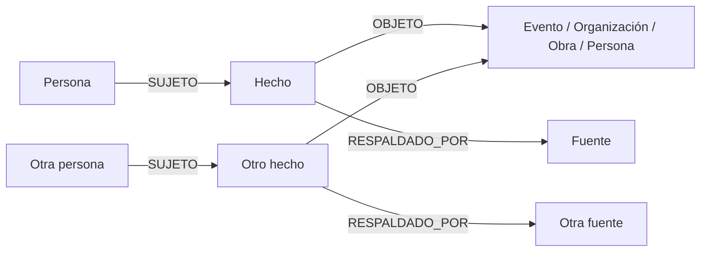

# Grafo de conexiones explicables

## Objetivo

Responder preguntas como «¿cómo se conecta Erling Haaland con Cleopatra VII?» con rutas comprobables. Cada salto debe decir **qué relación existe, cuándo ocurrió y qué fuentes la respaldan**. Si el grafo no contiene una ruta suficientemente sólida, la respuesta debe ser «no encontramos una ruta verificada»; nunca se debe completar una cadena por intuición.

Una ruta se compone únicamente de parentescos, interacciones o participaciones contemporáneas documentadas. Se puede cruzar de una época a otra solo mediante una **cadena continua de personas y hechos verificables**, por ejemplo generaciones de parentesco; una película moderna sobre Cleopatra no crea una conexión personal con ella. «Asistieron al mismo evento» no significa «se conocieron».

## Modelo canónico



| Nodo | Campos principales | Uso |
| --- | --- | --- |
| `Person` | `id` estable, nombre, alias, `wikidata_id` opcional, nacimiento/muerte con precisión | Identidad de la persona; el nombre no es una clave única. |
| `Fact` | `id`, `predicate`, `role`, periodo, `status`, **`primary_source_id` y `source_locator` obligatorios**, origen externo, fecha de revisión | Una afirmación específica respaldada por una fuente identificable; puede tener fuentes adicionales o estar disputada. |
| `Event` | `id`, título, tipo, fecha/periodo, lugar | Una **ocurrencia**: una reunión concreta, la firma de un tratado, un partido o una boda. |
| `Organization` | `id`, nombre, tipo | Club, equipo, institución, corte, gobierno. |
| `Work` | `id`, título, tipo, periodo de producción | Obra compartida por creadores o intérpretes contemporáneos; ser el tema de una obra posterior no crea una conexión personal. |
| `Place` | `id`, nombre, identificador externo | Contexto geográfico; compartir una ciudad no crea por sí solo una conexión. |
| `Source` | `id`, título, URL **o** cita bibliográfica/archivo, autor/editor, fecha de consulta | Evidencia que permite auditar el hecho concreto. |

Un `Fact` une un sujeto con un objeto y conserva detalles que una arista simple perdería. Por ejemplo:

```text
Haaland ─SUJETO→ Fact {predicate: MEMBER_OF, role: player, start: 2022,
                      primary_source_id: "source-123", source_locator: "plantilla 2022–23"}
                  └─OBJETO→ Manchester City
                  └─RESPALDADO_POR→ fuente de plantilla/temporada

Persona A ─SUJETO→ Fact {predicate: PARTICIPATED_IN, role: signatory,
                         primary_source_id: "source-456", source_locator: "página 4"}
                   └─OBJETO→ Firma del tratado X
                   └─RESPALDADO_POR→ documento o archivo
```

Dos firmantes se conectan mediante **el mismo evento de firma**, con un hecho y una fuente para cada participación. El texto del tratado puede ser una fuente. El evento compartido permite representar cualquier número de participantes sin inventar relaciones directas entre todos ellos.

### Predicados iniciales

| Grupo | Predicados canónicos | Conexión mostrada al usuario |
| --- | --- | --- |
| Familia | `PARENT_OF`, `SPOUSE_OF`, `SIBLING_OF` | «es padre/madre de», «fueron cónyuges», etc. |
| Interacción directa | `MET`, `COLLABORATED_WITH` | «se reunieron» o «colaboraron», solo cuando una fuente afirma esa interacción. |
| Evento | `PARTICIPATED_IN` con rol (`attendee`, `signatory`, `performer`, `organizer`...) | «participaron en el mismo evento», indicando los roles. |
| Organización | `MEMBER_OF` con rol e intervalo | «coincidieron en el mismo equipo/institución entre estas fechas». |
| Obra compartida | `CONTRIBUTED_TO` con rol e intervalo | «colaboraron en la misma obra», solo si ambos participaron en su creación o ejecución. |

Se pueden añadir predicados sin rediseñar el grafo, pero cada nuevo tipo necesita reglas de validación y una frase de presentación precisa. `MET` debe requerir evidencia de encuentro; no se deduce de que dos personas figuren en una conferencia.

## Tiempo, identidad y calidad

- `Person.id` es un UUID propio; `wikidata_id` ayuda a deduplicar. Una búsqueda por «Cleopatra» debe resolver explícitamente a Cleopatra VII u otra persona antes de consultar rutas. No usar `elementId()` ni el nombre como identificador público permanente.
- Las fechas históricas pueden ser aproximadas, parciales o anteriores a nuestra era. El modelo de entrada debe representar **año, era, precisión e incertidumbre**. Para ordenar años en la base de datos, propongo años negativos para AEC y positivos para EC, sin año cero en la API. La conversión desde Wikidata se debe probar por separado.
- `Fact` y `Event` guardan intervalos y precisión. Para decir que dos personas compartieron equipo se exige solapamiento temporal demostrable; si las fechas solo permiten una posibilidad, mostrar «posible coincidencia» y excluirla de las rutas verificadas.
- Estados de hechos: `verified`, `needs_review`, `disputed`, `rejected`. Las rutas recorren solo hechos `verified`. Un dato importado sin fuente verificable no se acepta como `Fact` consultable.
- Cada `Fact` debe tener `primary_source_id` y un enlace `SUPPORTED_BY` hacia una `Source` existente, creados en la misma transacción. `source_locator` identifica la página, sección o afirmación que respalda **ese hecho concreto**. Si hay más fuentes, se añaden enlaces `SUPPORTED_BY`; un URL genérico de la biografía no basta. La API debe rechazar hechos sin fuente y las pruebas deben cubrirlo.
- Nunca crear conexiones de camino a partir de «misma nacionalidad», «misma profesión», «nacieron en la misma ciudad», «pertenecieron al mismo club en épocas diferentes» o «una persona moderna hizo una obra sobre una figura antigua».

El modelo actual `PostFamous.date_born: date` no puede representar años AEC ni precisión de «aproximadamente 69 AEC». La imagen también debe pasar a ser opcional para personajes antiguos. Estos cambios requieren una nueva versión del contrato de la API, manteniendo temporalmente el endpoint existente.

## Búsqueda de rutas

Separaría **hechos guardados** de **conexiones derivadas para búsqueda**:

1. Validar identidades, fuentes, roles y fechas de los hechos canónicos.
2. Derivar conexiones persona-persona a partir de hechos compatibles: parentesco documentado, dos participantes de la misma ocurrencia, membresías con intervalos que se solapan, etc. La vista de búsqueda puede materializarse como `(:Person)-[:CONNECTION {kind, cost, fact_ids, source_ids, context_id}]-(:Person)`. Cada conexión conserva los IDs de **todos** los hechos y fuentes que la justifican; se reconstruye cuando cambian las fuentes. La dirección original del parentesco permanece en `Fact`.
3. Buscar candidatos con límite de personas intermedias, tipos permitidos y grado de eventos. Una ceremonia con miles de asistentes no debe conectar automáticamente a todos con todos.
4. Clasificar los candidatos. El número de saltos importa, pero una reunión documentada debería ganar a una cadena de coincidencias débiles. Penalizar incertidumbre y eventos demasiado generales; ofrecer varias rutas distintas cuando existan.
5. Devolver una explicación y fuentes por salto. Si no hay ruta bajo el límite elegido, informar el límite y permitir ampliar la búsqueda.

Para la primera versión bastan rutas acotadas y puntuación en Python, con un conjunto pequeño de conexiones derivadas. Si el grafo crece, Neo4j Graph Data Science ofrece Dijkstra para costo mínimo y Yen para varias rutas ponderadas; sería una dependencia opcional posterior. Un tramo `Persona → Evento → Persona` cuenta como **un salto semántico**, aunque internamente tenga varios enlaces.

Las fechas se validan **dentro de cada conexión**. Las relaciones entre contemporáneos requieren solapamiento real; el parentesco permite avanzar generación por generación. Una ruta asociativa no afirma que una noticia o persona «viajó» cronológicamente de un extremo al otro.

## API propuesta

```text
GET  /people/search?q=Cleopatra       # candidatos para desambiguación
GET  /people/{id}                      # perfil y conexiones verificadas
POST /people                           # alta o edición curada
POST /events                           # crea una ocurrencia concreta
POST /facts                            # requiere primary_source_id y localizador
GET  /paths?from_id=...&to_id=...&max_steps=6&limit=3
```

Cada ruta devuelve `score` y una lista ordenada de pasos con `from`, `to`, `kind`, `explanation`, `period`, `fact_ids`, `sources` y `derived`. Cada paso muestra las fuentes de los hechos que lo forman. La explicación se forma con plantillas de cada predicado; no se inventa texto libre que vaya más allá de los hechos.

## Organización gradual del repositorio

```text
app/modules/people/     # identidad, búsqueda y perfiles; transición desde famous/
app/modules/events/     # eventos y participantes
app/modules/facts/      # hechos, fuentes y revisión
app/modules/paths/      # rutas explicadas
app/services/           # validación temporal, derivación de conexiones, ranking
app/database/           # repositorios Neo4j y esquema de restricciones
app/integrations/       # importador Wikidata y Cloudinary
app/test/               # casos con grafos pequeños y fuentes ficticias
docs/                   # contrato del grafo y políticas de datos
```

No hace falta mover todo el código actual de golpe. Primero se añaden IDs estables y restricciones únicas, después el nuevo modelo y los endpoints; `famous` puede seguir funcionando como adaptador durante la migración. Antes de imponer unicidad por ID externo, hay que revisar los nodos existentes y resolver duplicados.

## Orden de implementación

La primera entrega con cliente web y API de carga manual está detallada en [phase-1-manual-editor.md](phase-1-manual-editor.md).

1. **Base verificable:** `Person`, `Fact`, `Source`, parentesco, IDs estables, `primary_source_id` obligatorio, periodos inciertos y restricciones; migración sin borrar `Famous`.
2. **Contextos compartidos:** `Event` y `Organization`, roles y solapamiento temporal; ejemplos curados de equipo, reunión y firma de tratado.
3. **Rutas:** desambiguación, conexión derivada, búsqueda acotada y explicación con fuentes; pruebas que rechacen coincidencias de distinta época.
4. **Datos externos:** importación idempotente de un conjunto pequeño de propiedades de Wikidata con calificadores y referencias; las afirmaciones sin fuente quedan en una cola de revisión, fuera del grafo consultable. Usar búsqueda de entidades para nombres y WDQS para consultas delimitadas, no para volcar todo el grafo.
5. **Escala y relevancia:** pesos calibrados con ejemplos reales, rutas alternativas, caché y, si hace falta, Graph Data Science.

El ejemplo Haaland → Cleopatra VII será una **prueba de calidad**, no una ruta garantizada. Sin atajos culturales, una cadena entre personas separadas por más de dos milenios necesitaría numerosos enlaces personales o generacionales verificables; seis saltos probablemente no basten. Si no existe esa cadena, la API responderá que no encontró una ruta bajo el límite consultado.

## Estado actual del código

Hoy solo existen el alta de `Famous` y el control de salud. Aún no hay nodos `Fact`, `Source`, `Event`, `Organization` o `Work`, ni rutas, carga de relaciones, validación de fuentes o búsqueda entre personas. Este documento define la implementación pendiente; no describe una función ya disponible.

## Referencias para el diseño

- [Neo4j: nodos intermedios y contextos compartidos](https://neo4j.com/docs/getting-started/data-modeling/modeling-designs/)
- [Neo4j: restricciones de unicidad](https://neo4j.com/docs/cypher-manual/5/constraints/create-constraints/)
- [Neo4j: alcance de `elementId()` y recomendación de IDs propios](https://neo4j.com/docs/cypher-manual/5/functions/scalar/)
- [Neo4j GDS: rutas ponderadas alternativas](https://neo4j.com/docs/graph-data-science/current/algorithms/yens/)
- [Wikidata: calificadores](https://www.wikidata.org/wiki/Help:Qualifier), [fuentes](https://www.wikidata.org/wiki/Help:Sources) y [fechas históricas](https://www.wikidata.org/wiki/Help:Dates)
- [Wikidata: acceso a datos y límites de uso de WDQS](https://www.wikidata.org/wiki/Wikidata:Data_access/en)
